<a href="https://alexalloukoutou.pro">
  <picture>
    <source media="(prefers-color-scheme: dark)" srcset="assets/dark/hero.svg">
    
  </picture>
</a>

  

  <a href="https://alexalloukoutou.pro/#contact"><picture><source media="(prefers-color-scheme: dark)" srcset="assets/dark/button-contact.svg"></picture></a>
  <a href="https://alexalloukoutou.pro"><picture><source media="(prefers-color-scheme: dark)" srcset="assets/dark/button-portfolio.svg"></picture></a>
  <a href="https://alexalloukoutou.pro/blog"><picture><source media="(prefers-color-scheme: dark)" srcset="assets/dark/button-blog.svg"></picture></a>
  <a href="https://www.linkedin.com/in/tund%C3%A9-lionel-alex-alloukoutou-940294233"><picture><source media="(prefers-color-scheme: dark)" srcset="assets/dark/button-linkedin.svg"></picture></a>

 

<picture>
  <source media="(prefers-color-scheme: dark)" srcset="assets/dark/section-competences.svg">
  
</picture>
<picture>
  <source media="(prefers-color-scheme: dark)" srcset="assets/dark/skills.svg">
  
</picture>

  

<picture>
  <source media="(prefers-color-scheme: dark)" srcset="assets/dark/section-projets.svg">
  
</picture>

  <a href="https://github.com/statcrafter/cnn-mnist-ml2"><picture><source media="(prefers-color-scheme: dark)" srcset="assets/dark/project-mnist.svg"></picture></a>
  <a href="https://github.com/statcrafter/knn-classifier"><picture><source media="(prefers-color-scheme: dark)" srcset="assets/dark/project-cifar.svg"></picture></a>
  <a href="https://github.com/statcrafter/econometrie-sierra-leone"><picture><source media="(prefers-color-scheme: dark)" srcset="assets/dark/project-econometrie.svg"></picture></a>
  <a href="https://github.com/statcrafter/r-projet-anova"><picture><source media="(prefers-color-scheme: dark)" srcset="assets/dark/project-anova.svg"></picture></a>
  <a href="https://github.com/statcrafter/deep-learning-journey"><picture><source media="(prefers-color-scheme: dark)" srcset="assets/dark/project-deep-learning.svg"></picture></a>
  <a href="https://github.com/statcrafter/guide-r-statistique"><picture><source media="(prefers-color-scheme: dark)" srcset="assets/dark/project-guide-r.svg"></picture></a>

 

<picture>
  <source media="(prefers-color-scheme: dark)" srcset="assets/dark/section-articles.svg">
  
</picture>
<a href="https://alexalloukoutou.pro/blog/avant-le-graphique-la-question-construire-un-indicateur-qui-aide-vraiment-a-decider">
  <picture>
    <source media="(prefers-color-scheme: dark)" srcset="assets/dark/article.svg">
    
  </picture>
</a>

  

<picture>
  <source media="(prefers-color-scheme: dark)" srcset="assets/dark/section-contributions.svg">
  
</picture>
<picture>
  <source media="(prefers-color-scheme: dark)" srcset="https://raw.githubusercontent.com/statcrafter/statcrafter/output/snake-dark.svg">
  
</picture>
